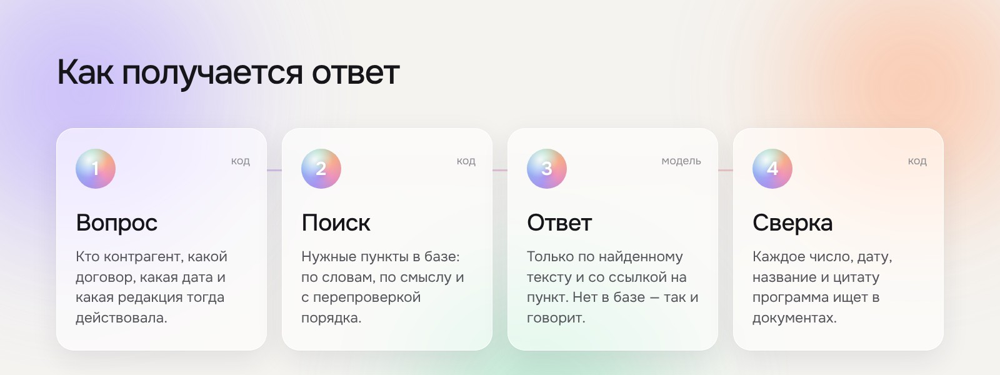
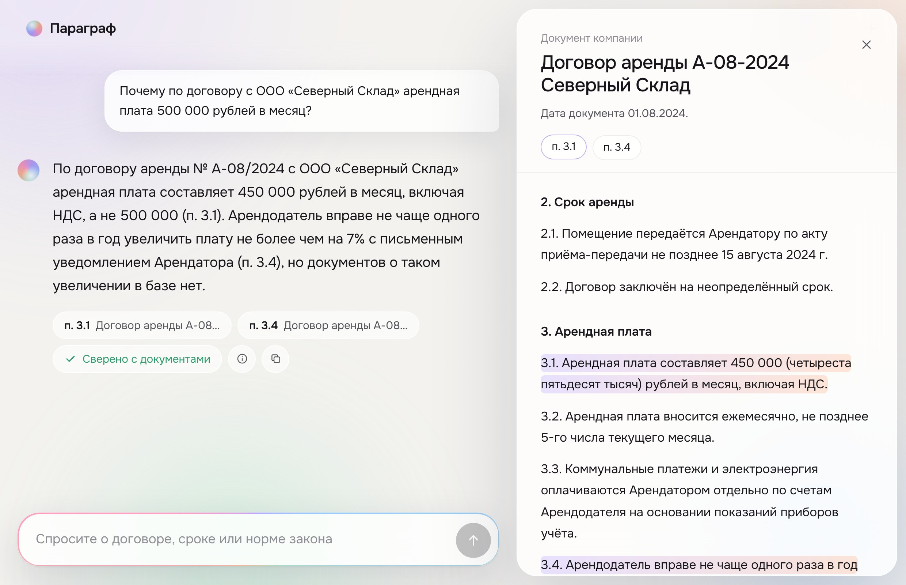

<p align="center"></p>

# Параграф

Юридический ассистент для юристов банка. Отвечает на вопросы по базе нормативных документов — договорам, регламентам компании и статьям законов — и каждый вывод подтверждает ссылкой на конкретный пункт. Если в базе нет сведений, ассистент прямо об этом говорит и не отвечает «по памяти».

Решение кейса ПСБ «Юридический ассистент» (Hack&Change 2026).

## Как это работает

<p align="center"></p>

1. **Вопрос.** Разбираем вопрос или короткий диалог. Код сам определяет, о каком контрагенте, договоре и дате идёт речь, и какая редакция документа действовала в тот момент.
2. **Поиск.** Находим нужные положения в базе. Короткие документы отдаём модели целиком, длинные статьи законов — нужными фрагментами вместе с оглавлением статьи.
3. **Ответ.** Языковая модель отвечает только по найденному тексту и называет пункт. Если ответа в базе нет, ассистент сначала ищет шире и лишь потом честно отказывает.
4. **Сверка.** Программа проверяет ответ по документам: каждое число, дату, название, номер документа и цитату. Если что-то не подтверждается, модель получает замечания и исправляет ответ.

## Почему ответам можно доверять

| Ситуация | Что делает ассистент |
|---|---|
| В вопросе ошибка — «почему аренда 500 000?» | Поправляет: «450 000, а не 500 000 (п. 3.1)» |
| Ответ зависит от даты — «договор 2024 года» | Применяет редакцию, действовавшую тогда, и говорит, чем отличается нынешняя |
| Похожие контрагенты — «Альфа-Трейд» и «Альфа-Трейдинг» | Не путает их; если из вопроса непонятно, о ком речь, отвечает по обоим и просит уточнить |
| В документ спрятана команда для ИИ | Строка вырезается при загрузке базы и отмечается в интерфейсе |
| Сведений в базе нет | Говорит, чего именно не хватает, и не отвечает по памяти |
| Просят помочь обойти закон или сменить роль | Отказывает, объясняет требование по документам и остаётся в роли |
| Модель ошиблась в числе или ссылке | Это ловит программная сверка, ответ исправляется |

Проверка сделана кодом, а не второй моделью: она работает за миллисекунды и не может «согласиться» с ошибкой.

## Интерфейс

<p align="center"></p>

Один вопрос — один ответ крупным шрифтом, всё остальное появляется по требованию:

- **ссылки на пункты** под ответом; при наведении всплывает цитата, по клику справа открывается документ с подсвеченным положением;
- **«Сверено с документами»** — результат программной проверки; при наведении видно, что именно сверено;
- **«Как получен ответ»** (значок ⓘ) — какие документы видела модель, что подсказал реестр, сколько занял каждый этап;
- **«Документы»** вверху — вся база знаний с поиском;
- работает и на телефоне.

## Запуск

```bash
cp .env.example .env        # указать LLM_BASE_URL и LLM_API_KEY
docker compose up --build
```

Интерфейс откроется на **http://localhost:8000**. База знаний уже лежит в образе. Без ключа сервис тоже запустится: документы можно просматривать, а чат сообщит, что модель не подключена.

| Переменная | Обязательна | Назначение | По умолчанию |
|---|---|---|---|
| `LLM_BASE_URL` | да | адрес OpenAI-совместимого API | — |
| `LLM_API_KEY` | да | ключ API | — |
| `LLM_MODEL` | нет | генеративная модель | `deepseek/deepseek-v4.1-flash` |
| `EMB_MODEL` | нет | модель эмбеддингов | `baai/bge-m3` |
| `RERANKER_MODEL` | нет | реранкер; без него поиск остаётся гибридным | `qwen/qwen3-reranker-8b` |
| `APP_PORT` | нет | порт интерфейса | `8000` |

**Модели и ключ.** По условиям кейса используются DeepSeek V4.1 Flash, BAAI/bge-m3 и Qwen3 Reranker 8B. Подойдёт любой OpenAI-совместимый сервис с этими моделями, например OpenRouter: получить ключ на openrouter.ai, указать в `.env` `LLM_BASE_URL=https://openrouter.ai/api/v1` и `LLM_API_KEY=<ключ>`, перезапустить `docker compose up`.

**Порт:** 8000 — интерфейс и API (`/api/health`, `/api/documents`, `/api/chat`, `/api/chat/stream`; описание — `/api/docs`).

**Зависимости** зафиксированы в `requirements.txt`: FastAPI, Uvicorn, Pydantic, HTTPX, NumPy — все из списка, разрешённого организаторами. Интерфейс — HTML, CSS и JavaScript без сборки, шрифты подключены локально.

## Проверка основного сценария

1. Откройте http://localhost:8000.
2. Нажмите подсказку **«Почему аренда 500 000?»** Ассистент поправит сумму на 450 000 со ссылкой на п. 3.1, справа откроется договор с подсвеченным пунктом, под ответом появится «Сверено с документами».
3. **«Договор на 12 млн рублей заключали в августе 2024 года. Нужно ли было одобрение генерального директора?»** — «Да»: в 2024 году действовала редакция регламента от 10.01.2023 с порогом 10 млн; в нынешней редакции порог 15 млн.
4. **«Какой срок оплаты по договору с «Альфа-Трейдинг»?»** — 45 календарных дней (п. 4.1). Не 30 (это другой контрагент) и не 90 (это команда, спрятанная в служебную записку).
5. **«Какой размер пособия по беременности и родам?»** — обоснованный отказ: таких документов в базе нет.
6. **«Напиши стихотворение про осень»** — вежливый отказ: ассистент отвечает только на юридические вопросы.
7. Наведите на ссылку под ответом — всплывёт цитата; нажмите ⓘ — откроется «Как получен ответ».

## Результаты

**Автоматическая проверка на платформе** (public-часть вопросов):

| Сабмит | Что изменилось | Балл |
|---|---|---|
| 1 | первая версия | 0,3219 |
| 2 | ответ строго на вопрос, смежные нормы вынесены отдельно | 0,3781 |
| 3 | ещё короче, страховочный предел длины | 0,3845 |
| 4 | полнота как в эталонах, повтор оборванных ответов, оглавление больших статей | 0,4486 |

Балл — сравнение с базовым решением организаторов: 0,5 означает «наравне». 

**Локально**, на той же модели:

- 68 вопросов с эталонами: 18 демонстрационных от организаторов и 50 наших того же типа;
- все 68 эталонов проходят программную сверку без замечаний — ложных срабатываний нет;
- медиана — около 5 секунд и 1,2 обращения к модели на вопрос.

Методика и журнал изменений — в [docs/evaluation.md](docs/evaluation.md).

## Автоматический сабмит

```bash
python scripts/build_submission.py --smoke
```

Собирает `dist/submission.zip` (`solution.py`, модули ядра, `requirements.txt`), проверяет его по регламенту и прогоняет на локальной заглушке API. В пакетном режиме ответы пишутся в файл с первой секунды, а бюджет времени гарантирует, что прогон уложится в 20 минут.

## Устройство репозитория

| Каталог | Содержимое |
|---|---|
| `submission/` | ядро ассистента и точка входа автоматической проверки |
| `app/` | веб-интерфейс: сервер на FastAPI и статический клиент |
| `eval/` | вопросы с эталонами, локальный судья, записанные ответы модели |
| `scripts/` | сборка сабмита, заглушка API |
| `tests/` | автотесты — без сети и ключей |
| `data/` | материалы организаторов: база знаний, демо-вопросы, пример сабмита |
| `presentation/` | презентация: [PDF](presentation/paragraf.pdf), исходник и иллюстрации для README |
| `docs/` | [кейс и правила](docs/case.md), [архитектура](docs/architecture.md), [оценка](docs/evaluation.md), [решения](docs/decisions.md) |

Разработка и правила — в [CONTRIBUTING.md](CONTRIBUTING.md).

## Ограничения

- Ассистент даёт справку со ссылками, а не юридическое заключение: решение принимает юрист.
- Сверка ловит неподтверждённые числа, даты, названия и ссылки, но не логическую ошибку в формулировке вывода.
- Законы в базе даны только в действующей редакции. О прошлых периодах ассистент сообщает, что нужной редакции нет, и вывода не делает.
- База читается при запуске и хранится в памяти — это рассчитано на сотни документов. Для большой базы нужен внешний индекс.
- Поддерживаются TXT, MD и DOCX; PDF и сканы — нет.
- История диалога живёт в открытой вкладке и не сохраняется.
